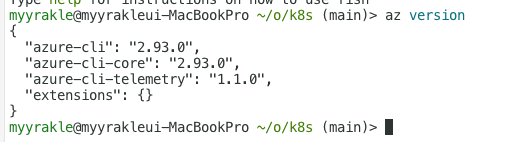
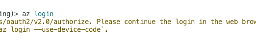
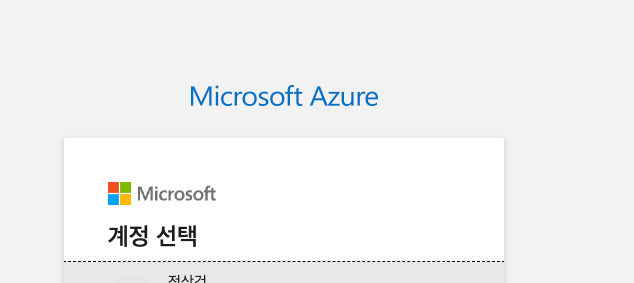
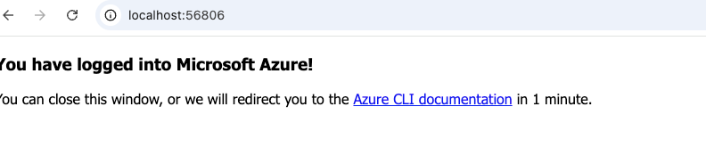
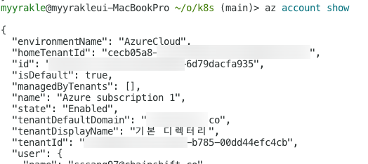
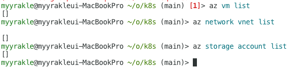

+++
title = "[Azure] Azure CLI"
date = 2026-11-17T04:40:42.743247+00:00
[taxonomies]
tags = ["Azure"]
[extra]
naver_log_no = 224480477097
naver_category_no = 217
+++

azure는 AWS에 비해서도 콘솔 UI가 좀 부실하고 불편한 편이라서 CLI가 필수다.  
기본적인 사용법 정도만 정리해본다.  

<br>

<br>

<br>

## 설치

macos라면 brew로 설치하면 되고  

```javascript
brew update
brew install azure-cli
```

리눅스면 명령 하나로 된다.  

```javascript
curl -fsSL 'https://azurecliprod.blob.core.windows.net/$root/deb_install.sh' | sudo bash
```

windows라면 인스톨러를 다운받는 것이 편하다.  
[https://learn.microsoft.com/ko-kr/cli/azure/install-azure-cli-windows?view=azure-cli-latest&pivots=winget](https://learn.microsoft.com/ko-kr/cli/azure/install-azure-cli-windows?view=azure-cli-latest&pivots=winget)  

아무튼 설치를 잘 했다면, az라는 이름으로 실행이 가능하다.  



<br>

<br>

<br>

## 로그인

login 명령을 사용하면 웹 기반으로 로그인이 된다.  






이렇게 뜨면 잘 된 것이다.  

<br>

<br>

<br>

## 기본 사용법

'az 리소스명 행동'의 형태로 사용하면 된다.  
내 계정 정보를 보려면 이렇게  



vm(가상머신) 목록을 보려면 vm list를 사용하는 식이다.  



<br>

<br>

참조  
[https://learn.microsoft.com/ko-kr/cli/azure/install-azure-cli-macos?view=azure-cli-latest](https://learn.microsoft.com/ko-kr/cli/azure/install-azure-cli-macos?view=azure-cli-latest)  
[https://learn.microsoft.com/ko-kr/cli/azure/?view=azure-cli-latest](https://learn.microsoft.com/ko-kr/cli/azure/?view=azure-cli-latest)
