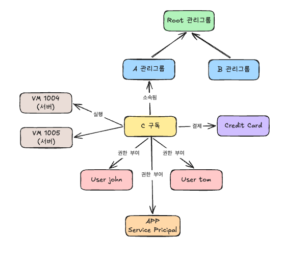

+++
title = "[Azure] 계정과 구독 구조"
date = 2026-11-17T05:50:42.786158+00:00
[taxonomies]
tags = ["Azure"]
[extra]
naver_log_no = 224480576856
naver_category_no = 217
+++

간단한 개념 설명 글이다.  

Azure는 기본 계층 구조가 제법 복잡한 편이다.  
AWS가 간단한 단일 계정 시스템으로 사용할 수도 있고 조직 단위 제어는 선택으로 두는 것과 다르게, 처음부터 조직 단위로 세팅하게끔 구조가 깔려있다.  

가장 중요한 것은 유저와 구독이다.  
구독이 실질적인 결제 비용 청구 대상 & 리소스 관리 책임 지점이 되고, 구독과 계정은 N:M으로 매칭된다.  

그림으로 정리하면 이런 느낌이 된다.  

 

 

#### 관리그룹 (Management Group)

관리그룹은 다른 시스템의 조직(organization)에 대응된다. 여러개의 구독 계정을 관리할 수 있는 그룹 단위다.  
조직이 계층적으로 나뉠 경우에 대응하기 위해서 관리그룹도 계층적 구성이 가능하다.  

 

 

#### 구독 (Subscription)

구독은 AWS의 일단 계정에 대응되는 존재다. 구독 단위로 결제가 되고, 리소스의 비용 책임까지를 떠맡는다.  
서버 같은 리소스도 구독 단위 아래에서 실행된다.  

 

 

#### 유저 (Entra User)

이게 사용자별 별도 계정이다. 유저는 여러개의 구독에 권한을 받고 실질적인 행동을 수행할 수 있다.  

 

 

#### Service Principal

유저 말고, 워크플로나 서버가 사용하기 위한 용도의 인증 단위다.  
User와 계층은 같으나, 콘솔 로그인이 안되고 액세스키 같은걸 기반으로 사용할 수 있다는 점이 다르다.  

 

 

참조  
[https://learn.microsoft.com/ko-kr/azure/governance/management-groups/overview](https://learn.microsoft.com/ko-kr/azure/governance/management-groups/overview)
