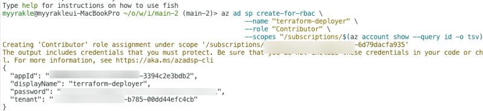
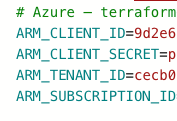
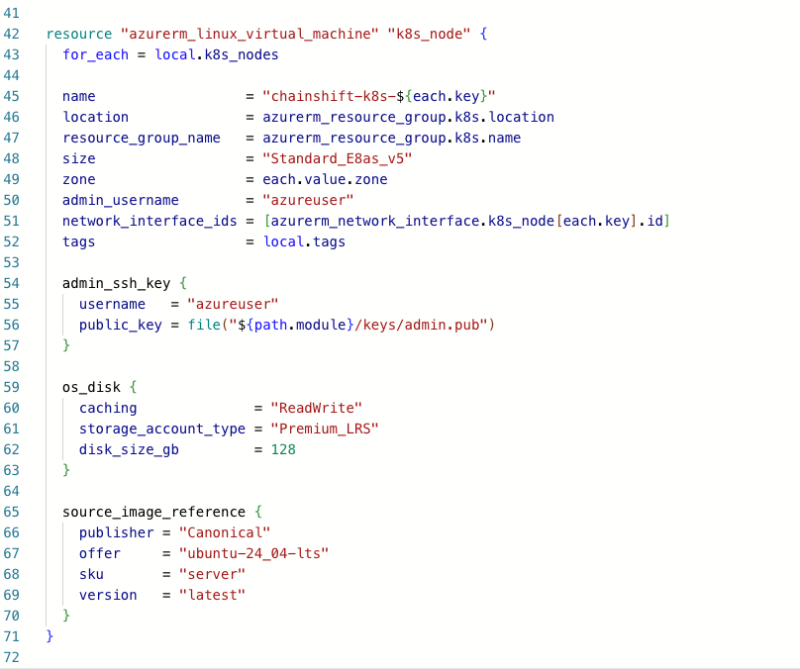
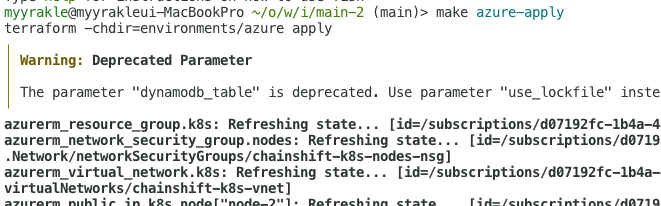
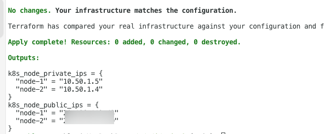

+++
title = "[Azure] Terraform으로 사용하기"
date = 2026-11-17T06:33:42.797294+00:00
[taxonomies]
tags = ["Azure"]
[extra]
naver_log_no = 224480639847
naver_category_no = 217
+++

먼저 terraform에서 사용할 Service Principal을 만든다.  

```javascript
az ad sp create-for-rbac \
  --name "terraform-deployer" \
  --role "Contributor" \
  --scopes "/subscriptions/$(az account show --query id -o tsv)"
```


그러면 AppID나 패스워드 등이 다 나오는데  

이걸 환경변수로 적절히 설정해준다.  



그리고 테라폼 코드를 적당히 세팅해준다.  

```javascript
terraform {
  required_providers {
    azurerm = {
      source  = "hashicorp/azurerm"
      version = "~> 4.0"
    }
  }
  required_version = ">= 1.0.0"
}

# 인증은 ARM_CLIENT_ID / ARM_CLIENT_SECRET / ARM_TENANT_ID / ARM_SUBSCRIPTION_ID 환경변수(.env) 사용
provider "azurerm" {
  features {}
}
```
이러면 자동으로 환경변수를 로드해서 알아서 잘 연결해줄 것이다.  

<br>


이후에는 표준적인 테라폼 문법을 사용해서 azure 리소스를 정의하고, 사용하면 된다.  

<br>




잘 되면 된 것이다.  

<br>

<br>

참조  
[https://learn.microsoft.com/ko-kr/azure/developer/terraform/overview](https://learn.microsoft.com/ko-kr/azure/developer/terraform/overview)  
[https://registry.terraform.io/providers/hashicorp/azurerm/latest/docs](https://registry.terraform.io/providers/hashicorp/azurerm/latest/docs)
